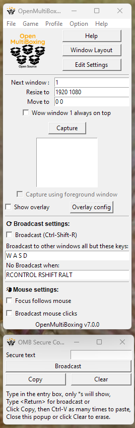

# OpenMultiBoxing (Open Source, safe, Multiboxing)

This is an extension of the project started for World of Warcraft multiboxing ([WowOpenBox](https://WowOpenBox.org/)) but that applies to any kind of Windows game or app, including browser games.

Download the [latest release](https://github.com/OpenMultiBoxing/OpenMultiBoxing/releases/latest) and see the [installation](https://github.com/OpenMultiBoxing/OpenMultiBoxing#installation) instructions.

Use the Game menu to select your Game, or Game > "Add game window title..." to add your game's window title (the dialog shows which windows currently match; use `*` to match a changing part, e.g. a version number in the title).

Or check the Capture using foreground window option:

You can then use the (configurable) hotkey `Ctrl-Shift-C` to capture whichever window you want.
After which your game name should be recorded in the Game menu and you can stick to normal Auto Capture (Options Menu).

OpenMultiboxing is known to work with:

- Blizzard Games (World of Warcraft, ...)
- EVE online
- Path of Exile
- Star Wars&trade;: The Old Republic&trade;
- Mir4
- Browser Games
- And pretty much any Windows 10 or 11 application...

And more... try and report your experience so we can add to this list!

Questions, suggestions, come on our 

Unlike WowOpenBox, which doesn't have any broadcasting capability, OMB since version 7 can **broadcast** any keys, any text/string (like your login password or a /command) as well left or right mouse clicks.

It can also do broadcasting across multiple PC connections since version 7.2.

Recap of the main features:

- Window Layout wizard and manual tweaking; get your game windows exactly how you want them to be to play.
   - Save different layouts as profiles (File > New Profile...) and cycle through them with the Ctrl-Shift-L (next) and Ctrl-Shift-Alt-L (previous) hotkeys. Pick which profiles are in the rotation with Profile > "Profiles in rotation..." (all but Default by default).
- Any game or app: pick it in the Game menu or add its window title with Game > "Add game window title..." (use `*` to match a changing part, e.g. a version number in the title).
- Instant swapping of windows; with keyboard hotkeys for fast switching to the next or any specific window.
   - Change any hotkey in File > "Hotkeys...": click it and press the new key combination (right click clears it, Undo goes back).
- Left and right **mouse click broadcasting** option (press W or both buttons or hold them for more than half a second (delay configurable in settings) to avoid broadcasting)
   - For applications that do not support mouse events through PostMessage, uncheck "Mouse broadcast: message mode" in the Options menu.
- **Key broadcasting** when turned on, with exclusions (e.g W A S D for movement from main window)
   - Skip some windows (e.g. 4 and 5) from key and mouse broadcasting: check "Skip" and pick them in its dropdown, toggle with Ctrl-Shift-E.
   - Some applications/games do not accept PostMessage as a way to get input keys and you need to use OMB 5.2.7 with RoundRobin instead.
- **Key remap** you can change which key code is sent to the other windows.
- **Mirrors** (v10.0.0+): live, zoomable copies of an area of any game window (e.g. a bigger minimap, or the portraits of the small windows), anywhere on screen. File > "Mirrors...": "Add a mirror", click a window, drag the area; then drag to move, drag the sides to extend/shrink the area, mouse wheel to zoom, right click for options. Mirrors stay on their window as it gets swapped (or follow whichever window is main) and let mouse clicks through outside of edit mode. See the [help](https://OpenMultiBoxing.org/help#mirrors).
   - **Mirrored layout** (v10.1.0+): check "Mirrored" in Window Layout to stack all the game windows under the main one and show the other positions as live mirrors of them: instant swaps (no resizing), click a mirror to make that window main; mouse clicks and movement broadcasting reach the stacked windows. See the [help](https://OpenMultiBoxing.org/help#mirrored-layout).
- **Multi-PC** broadcasting: Select "Listen for other OMB connections" in the options menu on the main computer. Select "Connect to..." in the File menu on the other computers, type the main computer's name. On the main computer, accept the connection request from the other computers (default port is 4464, can be changed in settings).
   - The main window shows the network status: number of connected remote PCs on the main one, "Pause input from ..." checkbox on the remotes.
   - On a remote PC with no captured window, keys go to the system and the mouse is scaled to the primary monitor (full screen). With one window, keys, clicks and mouse movement go to that window. With several, keys and clicks are repeated in each window (mouse movement is ignored).
   - You also have the Option to send mouse movements also to remote PCs.
- Secure text (password) broadcasting option (can also broadcast slash commands, etc)
- Many additional options to switch which window your keys are going to:
  - Swap windows with hotkeys.
  - Focus follow mouse: turns on/off the Windows&trade; accessibility feature so you just hover a window to make it receive keys (instantly: OMB sets the hover delay to 0 ms, below the 100 ms minimum of the Windows slider)
  - Focus next/previous/specific windows with hotkeys.
- Free, OpenSource and the Safest option available.
- Online [help](https://OpenMultiBoxing.org/help), menus and tooltips on most UI element to help discovering features.

Note: key broadcasting replaces earlier round robin in OpenMultiBoxing (and WowOpenBox has no possibility of broadcasting, per Blizzard's multiboxing changes).
